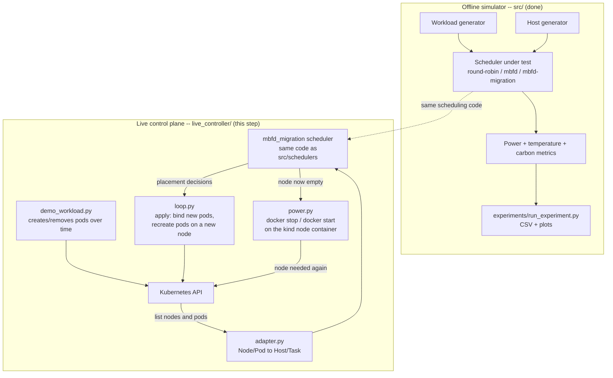

# Architecture

Two tracks exist side by side: an **offline simulator** (Step 1, done --
see `src/` and `experiments/`) that validates the scheduling algorithm in
isolation, and a **live control plane** (Step 2, this document + `live_controller/`)
that runs the *same* scheduling logic against a real Kubernetes cluster. Both
are shown here because a professor should be able to see the whole intended
system even though only part of it is built by midterm.

## Why the live side is a *controller*, not a custom `kube-scheduler` plugin

Kubernetes has two ways to influence pod placement: write a scheduler
extension (a `schedulerName` plugin implementing the Filter/Score/Bind
extension points), or run an external controller that watches the cluster
and moves pods after the fact (the pattern used by real tools like the
Kubernetes [descheduler](https://github.com/kubernetes-sigs/descheduler) and
Karpenter). We use the second pattern for the midterm PoC: it's
dramatically less code, still runs against a real API server and real pods,
and still proves the actual novelty (migration-cost-aware consolidation +
real power-down) end to end. Swapping in a real scheduler-framework plugin
is a legitimate final-term extension if there's time, not a must-have.

## What "migrating" a pod actually means here

Kubernetes has no live-migration primitive (unlike a VM hypervisor) --
moving a running pod to a different node means deleting it and recreating it
there, which is a real, brief disruption. That's not a limitation of our
implementation, it's a fact about containers, and it is exactly why the
migration-cost term in the objective function (see `NOVELTY.md` / `src/metrics.py`)
matters even more on real infrastructure than in the paper's pure simulation.

## What "powering down a node" actually means here

A `kind` cluster's "nodes" are Docker containers on your own machine. When
the controller evacuates a node, it runs `docker stop <container>` on that
node's container -- this is a real, measurable action: the container's CPU
and memory really are released back to the host machine, not just marked
"off" in a spreadsheet. `docker start` reverses it and the node rejoins the
cluster automatically once kubelet comes back up inside it.

## Round trip

1. `demo_workload.py` creates small pods (standing in for tasks) with CPU/
   memory requests, on a schedule, and later deletes some (task completion).
2. `loop.py` wakes up every `POLL_INTERVAL_SECONDS`, pulls current nodes +
   pods via `adapter.py`, and calls the *unmodified* `MBFDMigrationScheduler`
   from `src/schedulers/mbfd_migration.py` to get a placement decision.
3. New pods are bound to their assigned node (`nodeName`); pods that the
   scheduler decided to evacuate are deleted and recreated pinned to their
   new node.
4. Any node left with zero non-system pods is cordoned (so nothing new lands
   there) and its container is `docker stop`ped.
5. If an incoming pod doesn't fit anywhere active, the controller
   `docker start`s a stopped node, waits for it to rejoin, uncordons it, and
   places the pod there.
